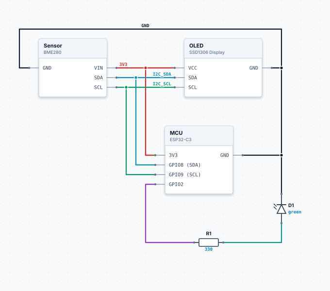
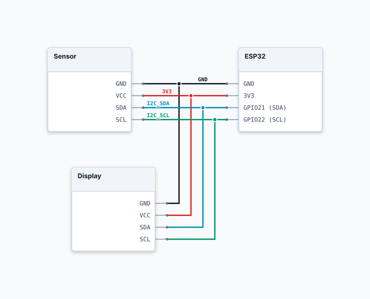
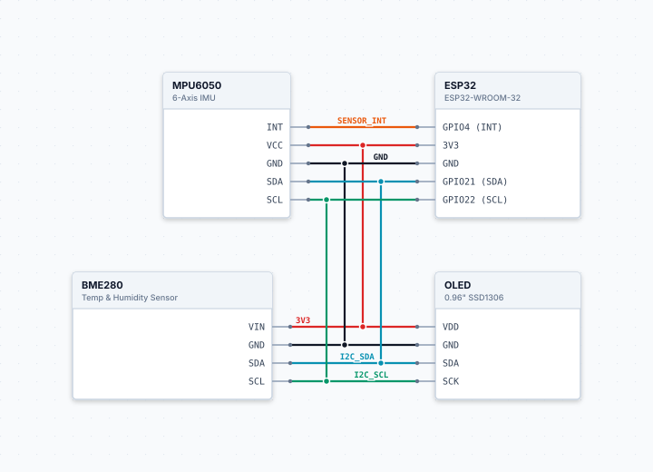
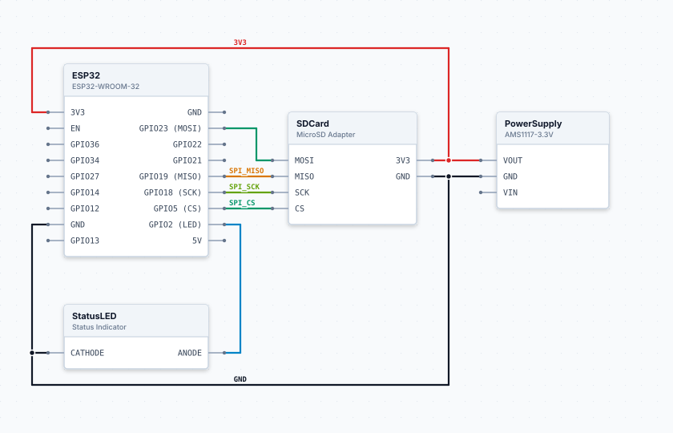
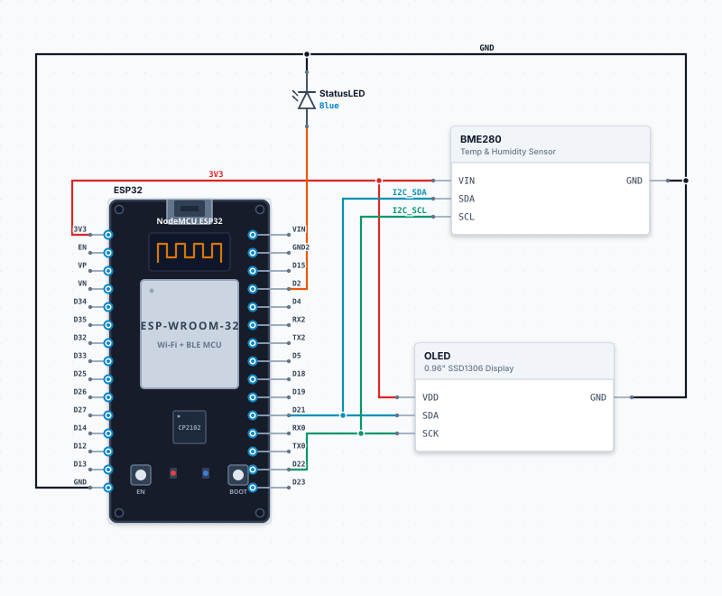

# schematic.txt

Write down how a circuit is wired, as plain text, and get a schematic you
can actually read. Parts are placed and wires routed automatically, with
the layout tuned for following wires by eye: few crossings, straight
connections, buses drawn as one trunk.

It is meant for documenting the wiring of hobby and embedded projects next
to the code, in Markdown, under version control. It is not a PCB or
simulation tool.

<!-- schematic.txt: image rendered from the source below; edit the source, not the image -->
<picture>
  <source media="(prefers-color-scheme: dark)" srcset="schematics/README-1f98f04a3c.dark.svg">
  
</picture>

<details>
<summary>Schematic source</summary>

```schematic
MCU: ESP32-C3
  pins: 3V3, GND, GPIO8(SDA), GPIO9(SCL), GPIO2

Sensor: BME280
OLED: SSD1306 Display
R1: resistor 330
D1: LED green

MCU.3V3 -> Sensor.VIN, OLED.VCC : 3V3
MCU.GND -> Sensor.GND, OLED.GND, D1.K : GND
MCU.GPIO8 -> Sensor.SDA, OLED.SDA : I2C_SDA
MCU.GPIO9 -> Sensor.SCL, OLED.SCL : I2C_SCL
MCU.GPIO2 -> R1.1
R1.2 -> D1.A
```

</details>

## Install

Python 3.10 or newer, no other dependencies. Run it without installing:

```sh
uvx --from git+https://github.com/FelixLttks/schematic.txt schematic --help
```

or install the `schematic` command with `pipx install
git+https://github.com/FelixLttks/schematic.txt` (or `pip install` in a
virtual environment).

## Schematics in Markdown

Put the description in a fenced block with the language `schematic`:

````markdown
```schematic
MCU.GND -> Sensor.GND
MCU.3V3 -> Sensor.VCC
```
````

GitHub shows unknown code blocks as plain text, so the images are rendered
ahead of time. `schematic md` turns each block into an SVG (one for light,
one for dark mode) in a `schematics/` folder next to the Markdown file,
and inserts the image above the block. The source stays in the file,
folded away under the image, and remains the thing you edit. The block in
this README went through exactly that.

```sh
schematic md README.md docs/   # files, or every *.md below a directory
schematic md --check .         # exit 1 if any image is missing or stale
```

Running it again only renders blocks that changed, and deletes images that
are no longer used.

### Keeping the images up to date

Treat the images like a lockfile: render them where you edit, commit them
with the Markdown, and let CI check that nobody forgot. Locally, the
[pre-commit](https://pre-commit.com) hook renders on every commit:

```yaml
# .pre-commit-config.yaml
repos:
  - repo: https://github.com/FelixLttks/schematic.txt
    rev: v0.1.0
    hooks:
      - id: schematic-md
```

This repository is also a GitHub Action. In check mode it renders nothing
and fails if an image is missing or out of date:

```yaml
# .github/workflows/schematics.yml
name: Schematics
on: [push, pull_request]
jobs:
  check:
    runs-on: ubuntu-latest
    steps:
      - uses: actions/checkout@v5
      - uses: FelixLttks/schematic.txt@v0
        with:
          check: "true"
```

`@v0` follows the latest 0.x release; pin a full version such as
`@v0.1.0` to update only on purpose. Inputs: `paths` (default `.`),
`effort`, `out-dir` (default `schematics`) and `check`. Use the same `effort` locally and in CI: it is part of the
image names.

<details>
<summary>Rendering in CI instead</summary>

If nobody who edits the Markdown has Python at hand, the action can render
and a workflow step commits the result. This adds a bot commit after each
change, so pull before you continue, and it needs a branch the workflow is
allowed to push to.

```yaml
name: Schematics
on:
  push:
    branches: [main]
    paths: ["**.md"]
concurrency: schematics  # one run at a time, later pushes wait
permissions:
  contents: write
jobs:
  render:
    runs-on: ubuntu-latest
    steps:
      - uses: actions/checkout@v5
      - uses: FelixLttks/schematic.txt@v0
      - name: Commit images
        run: |
          git config user.name "github-actions[bot]"
          git config user.email "41898282+github-actions[bot]@users.noreply.github.com"
          git add -A -- '*.md' '*.svg'
          git diff --cached --quiet || { git commit -m "docs: render schematics" && git push; }
```

Pushes made with the workflow's token do not trigger workflows again, so
this cannot loop.

</details>

## Live editor

```sh
schematic serve README.md
```

opens an editor with a live preview in the browser. Given a Markdown file,
it lists its schematic blocks; given a `.txt` file, it edits the whole
file. Changes in the browser are saved to the file, and changes made in
your own editor show up in the preview. Without a file it is a scratch pad.

The editor also has a part builder for [image parts](docs/syntax.md#image-parts):
upload a picture of a board and click on the grid to place its pins.

`schematic md --watch README.md` is the alternative if you prefer your
editor's Markdown preview: it re-renders the images on every save.

## Command line

```sh
schematic render board.txt                  # writes board.svg
schematic render board.txt -o - --theme dark --report
```

`--report` prints quality figures for the layout (crossings, bends, wire
length, a readability score). Every command takes `--effort`:

| Effort | Use | Time for ~20 parts |
|---|---|---|
| `fast` | live preview | seconds |
| `balanced` | default | about 2 min |
| `thorough` | dense circuits, final images | several minutes |

Small circuits take a few seconds at any level. Layout is deterministic:
the same input gives the same image.

From Python:

```python
from schematic_txt import render

svg = render("MCU.GND -> Sensor.GND", theme="dark", effort="fast")
```

## Syntax in short

```text
# Declaring parts is optional: parts used in connections exist automatically.
MCU: ESP32-C3
  pins: 3V3, GND, GPIO8(SDA)

# Resistors, capacitors, LEDs, diodes, fuses, switches and shunts are drawn as symbols.
R1: resistor 4.7k

# One pin to many, as a named net.
MCU.GPIO8 -> Sensor.SDA, R1.1 : I2C_SDA
MCU.3V3 -> R1.2
```

The full reference, including pin sides, YAML input and parts drawn from
images, is in [docs/syntax.md](docs/syntax.md).

## Examples

The inputs are also in [examples/](examples/).

### Quickstart

No declarations: parts and pins come from the connections.

<!-- schematic.txt: image rendered from the source below; edit the source, not the image -->
<picture>
  <source media="(prefers-color-scheme: dark)" srcset="schematics/README-45b3cfd64f.dark.svg">
  
</picture>

<details>
<summary>Schematic source</summary>

```schematic
ESP32.GND -> Sensor.GND, Display.GND
ESP32.3V3 -> Sensor.VCC, Display.VCC
ESP32.GPIO21(SDA) -> Sensor.SDA, Display.SDA : I2C_SDA
ESP32.GPIO22(SCL) -> Sensor.SCL, Display.SCL : I2C_SCL
```

</details>

### I2C sensor bus

Shared power and bus lines to three devices, drawn as trunks with
junctions.

<!-- schematic.txt: image rendered from the source below; edit the source, not the image -->
<picture>
  <source media="(prefers-color-scheme: dark)" srcset="schematics/README-61b4df0385.dark.svg">
  
</picture>

<details>
<summary>Schematic source</summary>

```schematic
ESP32: ESP32-WROOM-32
  pins: 3V3, GND, GPIO21(SDA), GPIO22(SCL), GPIO4(INT)

BME280: Temp & Humidity Sensor
  pins: VIN, GND, SCL, SDA

OLED: 0.96" SSD1306
  pins: VDD, GND, SCK, SDA

MPU6050: 6-Axis IMU
  pins: VCC, GND, SCL, SDA, INT

ESP32.3V3 -> BME280.VIN, OLED.VDD, MPU6050.VCC : 3V3
ESP32.GND -> BME280.GND, OLED.GND, MPU6050.GND : GND
ESP32.GPIO21 -> BME280.SDA, OLED.SDA, MPU6050.SDA : I2C_SDA
ESP32.GPIO22 -> BME280.SCL, OLED.SCK, MPU6050.SCL : I2C_SCL
ESP32.GPIO4 -> MPU6050.INT : SENSOR_INT
```

</details>

### SD card over SPI

Pins assigned to the left and right side of a part, and a regulator
feeding the board.

<!-- schematic.txt: image rendered from the source below; edit the source, not the image -->
<picture>
  <source media="(prefers-color-scheme: dark)" srcset="schematics/README-66ca01d977.dark.svg">
  
</picture>

<details>
<summary>Schematic source</summary>

```schematic
ESP32: ESP32-WROOM-32
  left: 3V3, EN, GPIO36, GPIO34, GPIO27, GPIO14, GPIO12, GND, GPIO13
  right: GND, GPIO23(MOSI), GPIO22, GPIO21, GPIO19(MISO), GPIO18(SCK), GPIO5(CS), GPIO2(LED), 5V

SDCard: MicroSD Adapter
  pins: 3V3, GND, MOSI, MISO, SCK, CS

PowerSupply: AMS1117-3.3V
  pins: VIN, GND, VOUT

StatusLED: Status Indicator
  pins: ANODE, CATHODE

PowerSupply.VOUT -> ESP32.3V3, SDCard.3V3 : 3V3
PowerSupply.GND  -> ESP32.GND, SDCard.GND, StatusLED.CATHODE : GND

ESP32.GPIO23 -> SDCard.MOSI : SPI_MOSI
ESP32.GPIO19 <- SDCard.MISO : SPI_MISO
ESP32.GPIO18 -> SDCard.SCK  : SPI_SCK
ESP32.GPIO5  -> SDCard.CS   : SPI_CS

ESP32.GPIO2  -> StatusLED.ANODE : LED_DRIVE
```

</details>

### Board drawn from an image

An [image part](docs/syntax.md#image-parts): the dev board is a picture
with its pins placed on a grid.

<!-- schematic.txt: image rendered from the source below; edit the source, not the image -->
<picture>
  <source media="(prefers-color-scheme: dark)" srcset="schematics/README-acdbb4c6b4.dark.svg">
  
</picture>

<details>
<summary>Schematic source</summary>

```schematic
part ESP32:
  image: examples/parts/esp32_devkit.svg
  size: 9x18
  pins:
    3V3:    0, 2
    EN:     0, 3
    VP:     0, 4
    VN:     0, 5
    D34:    0, 6
    D35:    0, 7
    D32:    0, 8
    D33:    0, 9
    D25:    0, 10
    D26:    0, 11
    D27:    0, 12
    D14:    0, 13
    D12:    0, 14
    D13:    0, 15
    GND:    0, 16
    VIN:    8, 2
    GND2:   8, 3
    D15:    8, 4
    D2:     8, 5
    D4:     8, 6
    RX2:    8, 7
    TX2:    8, 8
    D5:     8, 9
    D18:    8, 10
    D19:    8, 11
    D21:    8, 12
    RX0:    8, 13
    TX0:    8, 14
    D22:    8, 15
    D23:    8, 16

BME280: Temp & Humidity Sensor
  pins: VIN, GND, SCL, SDA

OLED: 0.96" SSD1306 Display
  pins: VDD, GND, SCK, SDA

StatusLED: led Blue
  pins: 1, 2

ESP32.3V3 -> BME280.VIN, OLED.VDD : 3V3
ESP32.GND -> BME280.GND, OLED.GND, StatusLED.2 : GND
ESP32.D21 -> BME280.SDA, OLED.SDA : I2C_SDA
ESP32.D22 -> BME280.SCL, OLED.SCK : I2C_SCL
ESP32.D2 -> StatusLED.1 : LED_CTRL
```

</details>

## Development

```sh
uv sync                      # virtual environment with the dev tools
uv run pytest -m "not slow"  # quick tests; plain `uv run pytest` runs everything
uv run ruff check && uv run ruff format --check
```

The full test run lays out every example and test case. Layout runs use
several processes, so run one at a time on a small machine.

[docs/layout-engine.md](docs/layout-engine.md) explains how placement and
routing work and why. Before changing the engine, compare against the last
commit with

```sh
uv run scripts/layout_report.py --baseline HEAD
```

which renders all examples and test cases with both versions and writes a
report with metrics and images to `build/layout-report/`.

## License

[MIT](LICENSE)
